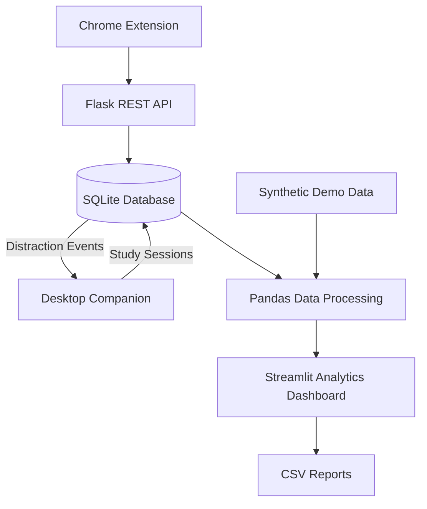

# 🌱 Smiski Focus

A desktop productivity companion that combines distraction blocking,
Pomodoro timers, and interactive study analytics to help students
understand their study habits.

## ✨ Features

- Animated desktop companion with customizable poses and sizes
- Instagram blocking through a Chrome extension
- Customizable Pomodoro focus and break timers
- Real-time distraction counter
- Automatic study session tracking
- Persistent settings using JSON
- SQLite database for historical records
- Interactive analytics dashboard
- Downloadable CSV reports
- Single-click Windows launcher

## 📊 Analytics Dashboard

The dashboard provides:

- Total recorded focus time
- Session completion rates
- Average session duration
- Completed and unfinished session statistics
- Daily focus trends
- Instagram blocking trends
- Hourly distraction patterns
- Weekly distraction heatmaps
- Seven-day moving average of focus time
- Focus time analysis by session starting hour
- Distraction and session completion comparison
- Automated descriptive insights
- Custom date range filtering
- CSV data exports

### Demo Mode

Demo Mode allows users to explore the analytics dashboard
without collecting personal study data.

- Generates 30 days of synthetic study records
- Uses a fixed random seed for reproducibility
- Supports existing charts, filters, and CSV exports
- Keeps synthetic data separate from personal records
- Does not insert synthetic records into SQLite

Enable Demo Mode through the dashboard sidebar.

## 🛠️ Tech Stack

| Technology | Purpose |
|------------|---------|
| Python | Backend and application logic |
| JavaScript | Chrome extension |
| HTML/CSS | User interface |
| PyQt6 | Desktop GUI |
| Flask | Local REST API |
| SQLite | Database management |
| Pandas | Data processing and analysis |
| Plotly | Interactive data visualization |
| Streamlit | Analytics dashboard |
| Pillow | Desktop icon generation |
| Git/GitHub | Version control |

## 🏗️ System Architecture



The Chrome extension detects Instagram visits and sends
blocking events to a local Flask API.

The API stores these events in SQLite. The desktop companion
retrieves distraction counts and records focus sessions.

Pandas processes the collected data, while Streamlit and
Plotly provide interactive visualizations and descriptive
statistics.

## 📁 Project Structure

```text
smiski-focus/
├── .streamlit/
│   └── config.toml
├── chrome-extension/
│   ├── background.js
│   ├── content.js
│   ├── manifest.json
│   ├── popup.html
│   └── popup.js
├── smiski.py
├── server.py
├── database.py
├── dashboard.py
├── launcher.pyw
├── create_icon.py
├── install.bat
├── start.bat
├── requirements.txt
├── .gitignore
└── README.md
```

## 🚀 Installation

### Prerequisites

- Windows
- Python 3.11
- Google Chrome
- Git (optional)

### 1. Obtain the project

Clone the repository or download it as a ZIP file.

### 2. Install dependencies

Open a terminal inside the project folder and run:

```powershell
py -3.11 -m pip install -r requirements.txt
```

Alternatively, run `install.bat`.

### 3. Prepare image assets

Provide your own permitted PNG images named:

- work.png
- sleep.png
- push.png
- peek.png

Place copies of these images in both the main project folder
and the `chrome-extension` folder.

Image assets are not distributed with this repository.

### 4. Initialize the database

```powershell
py -3.11 database.py
```

### 5. Launch the application

```powershell
py -3.11 launcher.pyw
```

Alternatively, double-click `start.bat`.

The launcher starts the local Flask server, analytics
dashboard, and desktop companion.

### 6. Install the Chrome extension

1. Open Google Chrome.
2. Navigate to chrome://extensions/.
3. Enable Developer Mode.
4. Click Load unpacked.
5. Select the chrome-extension folder.
6. Enable focus mode through the extension popup.

The desktop application should be running to enable
distraction logging and real-time analytics.

### 7. Open the analytics dashboard

Visit http://127.0.0.1:8501 or select
Open Analytics Dashboard from the desktop companion menu.

Enable Demo Mode to explore the dashboard using
synthetic study records.

## 🔒 Privacy

- Study records and distraction history are stored locally.
- Application settings are stored locally using JSON.
- Personal databases, settings, and logs are excluded
  from version control.
- Demo Mode does not modify personal study records.
- The Flask API runs locally on the user's computer.

## 📚 Learning Outcomes

This project explores:

- Relational database design and SQL queries
- REST API integration
- Data cleaning and transformation
- Feature engineering
- Exploratory data analysis
- Descriptive statistics
- Time-series analysis and moving averages
- Synthetic data generation
- Interactive data visualization
- Desktop application development
- Browser extension development
- Version control using Git and GitHub

## ⚠️ Current Limitations

- Currently designed for Windows and Google Chrome.
- Website blocking currently supports Instagram.
- Distraction logging requires the local server to be running.
- User-provided image assets are required.
- Recorded focus time does not measure actual productivity.
- Statistical comparisons do not establish causation.

## 🔮 Future Improvements

- Additional customizable website blockers
- Study goals and progress tracking
- Improved application packaging
- Long-term study pattern analysis
- Cross-platform support

## Development Note

Developed as a personal learning project with AI-assisted
programming, debugging, and documentation.

## Disclaimer

This is an unofficial, non-commercial student project.
It is not affiliated with the Smiski brand.

All third-party artwork belongs to its respective owners.
Users must provide image assets they have permission to use.

Focus time measures recorded timer usage rather than
verified productivity.
